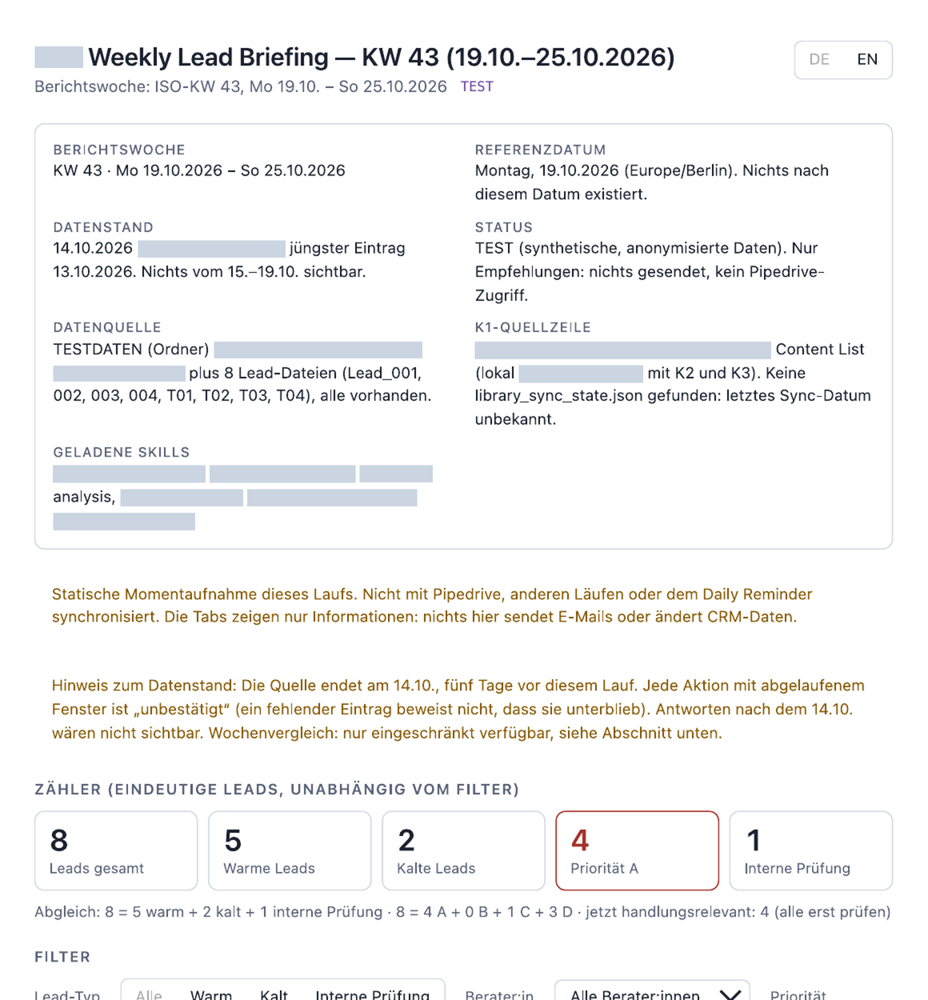
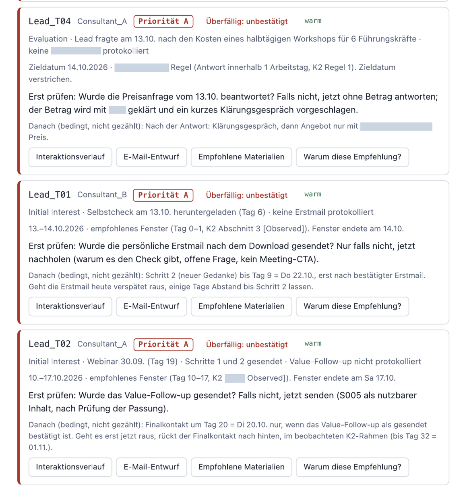
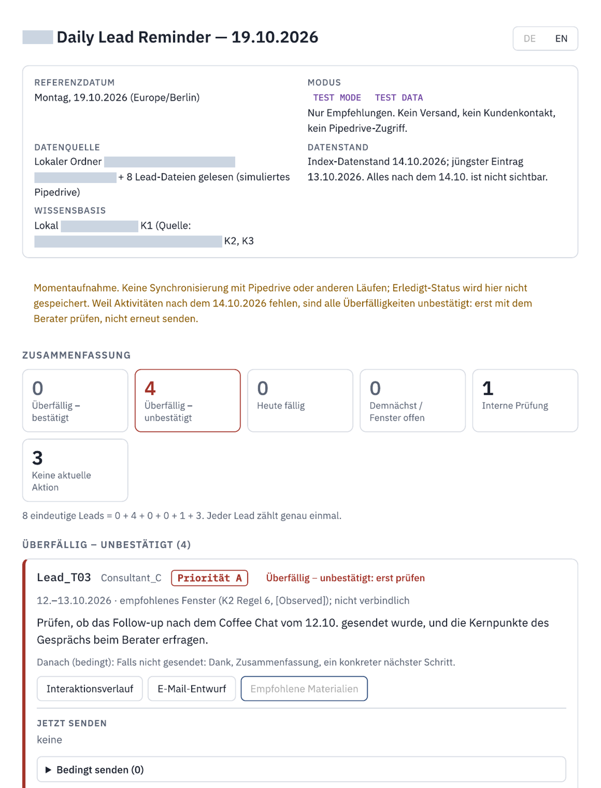
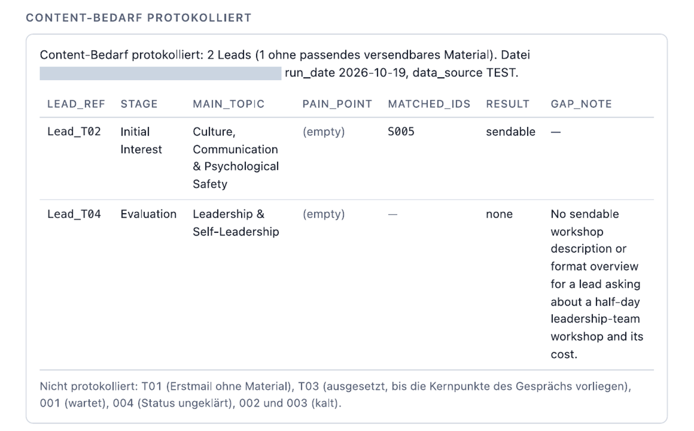
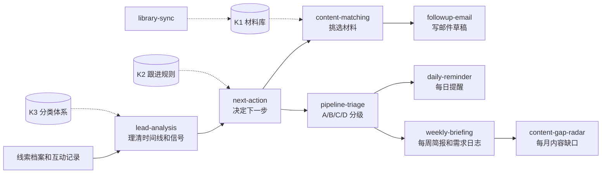

# Warm-Lead Follow-up Assistant：用 Claude 做销售线索跟进

这是我在 TUM 读书期间参与的一个项目研究（Project Study，2026 年 6 月至 11 月）。我们三个学生和一家德国中小型管理咨询公司合作（按保密协议，下文称“客户”），帮客户的销售顾问判断：哪个线索该跟进、什么时候跟进、发什么材料、邮件怎么写。

先说明一点：这个项目不是一个能单独运行的软件。它由 Skills、提示词、知识库、业务规则和定时任务配置组成，要装进 Claude 桌面版（用到 Projects、Skills 和 Scheduled Tasks）才能用。它给出的只是建议和邮件草稿，不会自己发邮件，也不会改 CRM。

目前它是测试模式的原型。我们在合成数据和客户提供的匿名数据上跑过、评过分，还没有接入客户真实的 CRM 和 OneDrive。

客户名称、客户知识库、客户提供的匿名测试案例和 Skills 原文都没有放在这里，原因见 [PUBLICATION_NOTES.md](PUBLICATION_NOTES.md)。

## 1. 要解决的问题

客户的潜在客户很多来自网络研讨会、自测问卷下载和线下见面，我们叫它们“暖线索”。一个线索往往要 6 到 12 个月、7 到 10 次接触才可能成交，没回复也不代表没兴趣。这些跟进目前全靠顾问手工记、手工判断、手工写邮件。

顾问每天要回答四个问题：

1. 这个线索现在该不该联系？CRM 里的点击有不少是邮件安全扫描器几分钟内把所有链接点了一遍，不能当成兴趣。
2. 下一步做什么？我们希望它按客户自己的跟进习惯来判断，有时候“先不联系”就是对的答案。
3. 发什么材料？只能从客户批准对外发送的材料里选，最多两份。
4. 邮件怎么写？德语，用顾问本人的口吻，du 和 Sie 不能用错，一封邮件只问一个问题，不报价。

最后拍板和发送的始终是顾问。

## 2. 做了哪些功能

| 功能 | 输入和输出 | 目前状态 |
|---|---|---|
| 单个线索分析 | 输入线索档案和互动记录，输出六部分：线索概况、现状判断、下一步、推荐材料、邮件草稿、需要顾问确认的问题 | 已实现，经过 3 轮人工评分 |
| 多个线索排优先级 | 输入多个线索，按 A 今天处理、B 本周处理、C 内部先核实、D 等待 分级 | 已实现，已测试 |
| 每日提醒 | 定时任务读取线索数据，生成一个可交互的看板 | 已实现，2026-10-19 在测试数据上跑过 |
| 每周简报 | 定时任务读取全部线索，生成周报看板，同时记录内容需求日志 | 已实现，系统测试 75 项检查通过 68 项 |
| 内容缺口雷达 | 根据内容需求日志和材料库，每月汇总缺哪类材料 | 计算部分测试通过（8/8）；无人值守运行时没能自动更新看板，目前要手动触发 |
| 材料库同步 | 从客户 OneDrive 读取材料变化并更新材料库 | 已写好，但 OneDrive 还没接入，没有测试过 |

定时运行、看板渲染（Artifacts）、Projects 和 Skills 的加载机制都是 Claude 平台本身的功能。我们做的是在这些功能上面设计业务逻辑、规则、提示词、输出格式和测试方法。

## 3. 运行截图

下面是 2026-10-19 在测试数据上实际运行的输出，界面是德语。客户名称、文件名和带客户前缀的 Skill 名称我用灰色块遮住了。

每周简报的头部和计数器。页面上写明了这是测试数据、数据截止到哪天，以及“这是静态快照，不会发邮件，也不会改 CRM”：



每周简报的线索卡片。测试数据截止在 10 月 14 日，比运行日期早五天，所以过了期限的动作都标成“未确认，先核实”，没有直接让顾问重发：



每日提醒。8 个线索分到 6 个互不重叠的类别里（0+4+0+0+1+3），每个线索只算一次：



## 4. 一个完整的例子：线索来问价格

Lead_T04 是我们团队自己编的测试线索，不是真实客户。我隐去了客户名和材料名，其他没有改动。下面的输出摘自 2026-10-19 那次运行，整理作品集时没有重新跑。完整版本在 [case_study/demo_case_T04.md](case_study/demo_case_T04.md)。

输入是一份模拟的 CRM 记录，数据截止到 2026-10-14：

| 日期 | 谁联系谁 | 发生了什么 |
|---|---|---|
| 15.09 | 线索联系客户 | 下载了一份自测问卷 |
| 16.09、22.09、02.10 | 客户联系线索 | 发了三封跟进邮件，前两封没回 |
| 13.10 | 线索联系客户 | 回复：“Spannend. Was würde ein halbtägiger Workshop für mein Führungsteam (6 Personen) ungefähr kosten?”（很有意思。给我 6 个人的管理团队做半天工作坊，大概多少钱？） |

周报和日报给出的结论是一样的：

- 优先级 A，过了期限但未确认。按规则，线索回复后要在一个工作日内回应，也就是 10 月 14 日之前。数据里没有回复记录，但没记录不等于没回。
- 下一步：先确认 13 号的询价有没有回过。如果没有，现在回复，但不写金额。价格由顾问和公司商量，再约一次简短的电话。
- 之后的步骤只作为备注，不算进当前待办：通话之后再给一份价格经过公司批准的方案。
- 材料：现在没有可以发的。材料库里有一份带价格的方案模板，形式上标的是可发送，但它其实是内部报价用的，所以只作为顾问的内部参考。
- 内容需求日志记了一条：这个线索没有合适的对外材料，缺的是一份工作坊介绍或形式说明。月度雷达会把这类记录汇总起来，提醒客户补内容。



## 5. 工作流是怎么设计的



一共 10 个 Skills，每个只负责一件事，互相调用。单个线索、每日提醒、每周简报三个入口用的是同一套判断，这样同一个线索在不同地方得到的结论是一致的。

知识库是客户的内部资料，这里只说结构：

- K1 材料库：74 条材料，每条标了主题、客户痛点、销售阶段、适合什么情况，以及能不能对外发（可发送、待确认、仅作背景参考）。
- K2 跟进规则：标准的跟进节奏、什么时候算线索变冷、各种特殊情况（线索回复了、改期了、已经成交、来问价格等）。每条规则我都标了来源：客户确认过的、从数据里观察到的、还是我们团队的假设。
- K3 分类体系：10 个主题、20 个客户痛点和销售阶段，分析和匹配材料时用同一套词。

我们给它定了几条底线：不报价；不编造会议内容和材料细节；扫描器的自动点击不算兴趣；最后一封邮件发出后不再追；记录里没有的动作不默认为没做；人名一律用占位符。

更详细的设计见 [docs/01_workflow_design.md](docs/01_workflow_design.md)。

## 6. 测试和迭代

下面只列有记录的结果：

| 测试 | 日期 | 范围 | 结果 | 执行 |
|---|---|---|---|---|
| 第 1 轮 | 2026-10-10 | 17 个决策点，来自客户提供的匿名历史线索 | 17 个的下一步都判断正确，平均约 9.9 分（满分 10）；发现 8 类问题并修改 | 队友 |
| 第 2 轮 | 2026-10-15 | 7 个决策点，加 9 个我们编的边界情况，每个案例单独开对话 | “下一步”一项全部满分；两组平均分 9.14 和 9.11 | 队友 |
| 第 3 轮 | 2026 年 10 月 | 17 个决策点加 9 个边界情况，复测一致性 | “下一步”一项 26 个全部满分；总分 239/250 | 团队 |
| 系统测试 | 2026-10-19 | 8 个测试线索上的定时周报、看板界面、需求日志、雷达、文件安全 | 周报相关的 75 项检查通过 68 项，没通过的几项不影响建议本身；雷达计算 8/8；雷达自动更新失败 | 队友 |

评分时，每个案例按理解、下一步、时机、材料、邮件五项各打 0 到 2 分，和事先写好的参考答案对比。决策点的参考答案主要来自客户当时真实的做法；边界情况的参考答案是我们按规则写的，客户没有确认过。

测试之后改了不少东西，比如：一封邮件只留一个问题；没核实过的视频内容不再写成事实；联系人一律用 `[Name]` 占位；不再从下载的主题直接推断客户的痛点；“过期”分成“确认过期”和“未确认”两种；日报和周报推荐材料的方式统一成同一套字段。

还有一些局限：系统测试只有 8 个线索；没有接入真实的 CRM 和 OneDrive；邮件写得好不好，最终要顾问来判断；10 月 22 日交付最终版本之后，没有再完整测一遍。详见 [docs/02_testing_and_iteration.md](docs/02_testing_and_iteration.md)。

## 7. 我做了什么，团队做了什么

我负责的部分：

- 设计和编写其中四个核心 Skills：`lead-analysis`、`next-action`、`daily-reminder`、`weekly-briefing`，包括判断顺序、输入输出格式和底线规则。
- 把客户的跟进决策整理成按顺序判断的规则（K2），并逐条标注来源。
- 设计材料库的分类体系：主题、客户痛点、销售阶段、发送状态这些分类和打标字段（K3 和 K1 的结构）。
- 检查测试案例的内容和参考答案。
- 整理最终的安装包：10 个 Skills、4 个定时任务模板、一份德语安装指南，以及一份让 Claude 自己按步骤安装的说明。

和团队一起做的：前期的 Agent 流程设计是我们一起讨论出来的；测试和迭代也是一起做的，包括多轮测试和根据结果修改 Skills。

队友负责的：需求梳理和客户沟通、客户材料的逐条整理和打标、其余的 Skills（`content-matching`、`followup-email`、`pipeline-triage`、`content-gap-radar`、`library-sync` 等）、测试数据准备、第 1、2 轮测试的执行和 10 月 19 日的系统测试报告。

## 8. 使用条件和局限

- 需要 Claude 桌面版，并且能用 Skills 和 Projects。定时任务运行时，电脑要开着，App 要打开。
- 现在读的是本地测试文件夹里的合成线索和匿名线索。接 Pipedrive 和 Microsoft 365 还需要额外配置和授权。
- 它只给建议，不发邮件，不写 CRM，顾问看过之后自己发。
- 已知问题：月度雷达无人值守时上传看板数据被权限拒绝；有几封邮件草稿比我们定的 80 词下限短；手机宽度下周报会横向多出 3 像素。
- 还没做的：接入真实 CRM 的只读数据、接入 OneDrive 同步材料、根据顾问的修改调整邮件风格。

## 9. 安装和文件说明

这个仓库只用来展示，里面没有能直接安装的 Skills，也没有客户的知识库。实际安装分 7 步，按指南大约 30 到 45 分钟，概要见 [docs/03_setup_overview.md](docs/03_setup_overview.md)。

```
github_showcase/
├── README.md                      本页
├── PUBLICATION_NOTES.md           哪些内容没有公开，为什么
├── docs/
│   ├── 01_workflow_design.md      Skills、知识库结构和底线规则
│   ├── 02_testing_and_iteration.md 测试方法和结果
│   └── 03_setup_overview.md       安装条件和步骤
├── case_study/
│   └── demo_case_T04.md           询价案例的完整版
├── examples/
│   ├── lead_record.example.md     线索输入格式示例
│   └── scheduled_task.example.txt 定时任务配置示例（已泛化）
└── screenshots/                   4 张遮盖过的运行截图
```
